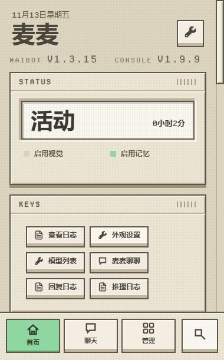

# dy-bot：把 Gemini 接进抖音群聊

dy-bot 是一个抖音群聊机器人。它通过 Karin 抖音适配器收发消息，用 WebSocket 把群聊交给 MaiBot，再由 MaiBot 调用 Gemini 判断要不要接话、生成回复。它可以参考群友刚聊过的内容、理解引用文字，也能在需要时检索过去的聊天摘要和人物记忆。

这个仓库包含抖音到 MaiBot 的消息桥接、安装脚本、配置模板和测试。大模型调用、对话规划与长期记忆由 MaiBot 提供；项目不需要 LangChain，也不需要本地显卡。

## 管理面板



MaiBot 面板用于调整人设、模型、发言时机和长期记忆。抖音群白名单和实际发送限额还需要在 dy-bot 的本地配置里设置。

## 开始之前

- **系统**：Windows 已验证实群文字收发。Linux 有安装路径支持，但原生依赖、扫码和实群收发需在目标机器上复测。
- **软件**：[Node.js](https://nodejs.org/) 22.13 或以上、[pnpm](https://pnpm.io/installation)（项目固定版本见 `package.json`）、[Python](https://www.python.org/downloads/) 3.12 或以上，以及 [Git](https://git-scm.com/)。
- **账号**：能扫码登录的抖音账号，且已经加入想测试的群。建议先用自己的测试群。
- **模型**：在 [Google AI Studio](https://aistudio.google.com/apikey) 创建 Gemini API Key。确认当前部署机器的网络可调用 [Gemini API](https://ai.google.dev/gemini-api/docs/available-regions)，并在 [模型列表](https://ai.google.dev/gemini-api/docs/models) 选择项目可用、支持工具调用的聊天模型。API 有自己的额度和计费规则。

## 1. 下载与安装

在 GitHub 点 **Code → Download ZIP**，解压后在项目根目录打开 PowerShell 或终端。也可以从 **Code** 复制 HTTPS 地址，用 `git clone` 下载。先确认 `node -v`、`pnpm -v`、`python --version` 和 `git --version` 能运行，然后执行：

```sh
pnpm install --frozen-lockfile
pnpm setup:local
pnpm bootstrap
```

第一条安装 Node.js 依赖，第二条创建缺失的本地配置，第三条下载并校验固定版本的 MaiBot、安装独立 Python 环境并应用兼容补丁。如果脚本选错了 Python，可执行 `pnpm bootstrap --python python3.12`，或把 `python3.12` 换成 Python 的绝对路径。

如果模型或安装下载需要 HTTP 代理，先在 `config/network.local.json` 填写 `geminiProxyUrl`，例如 `http://127.0.0.1:7890`。不需要时留空。这个地址是运行 dy-bot 的机器自己的地址；抖音连接走直连。

## 2. 扫码并找到群 ID

```sh
pnpm login:douyin
```

打开终端提示的 `data/douyin-login.png`，用抖音 App 扫码并在手机上确认。完成后终端会列出账号已加入的群，以及程序使用的内部群 ID。**复制终端里的 ID**，手机界面显示的群号码可能不同。

首次扫码会自动填写 `config/maibot.local.json` 的 `accountId`（仅在原字段为空时）。正常重启会复用本地会话。登录失效时先停止网关，再重新扫码。

## 3. 填写模型和群配置

编辑 `config/` 下的本地文件，保留已有的其他字段。不要把实际值填到 `*.example.json` 里。

| 文件 | 填什么 |
| --- | --- |
| `model.local.json` | `apiKey` 填自己的 Gemini 密钥，`model` 填模型 ID，`botName` 可改为想用的名字。使用 Gemini 原生接口时保留默认 `adapterType` 和 `baseUrl`。 |
| `local.json` | `allowedGroups` 填群 ID 的数组，例如 `["1234567890123456789"]`。群 ID 必须加引号，避免长数字精度丢失。 |
| `maibot.local.json` | 确认 `accountId` 是本次登录的账号；`groupNames` 可填 `{"1234567890123456789":"测试群"}` 方便看日志。自动生成的 `token` 保持不变。 |
| `network.local.json` | `geminiProxyUrl` 按需要设置。 |

保存后执行：

```sh
pnpm configure
pnpm test:model
```

`configure` 将模型、人设、记忆和群白名单写入 MaiBot。`test:model` 验证聊天生成、向量嵌入和工具调用，会消耗少量模型额度，但不会发群消息。后续已有人设时不要为了改一个字段重跑 `configure --overwrite`，它会重写部分现有配置。

## 4. 首次启动和测试

1. 在第一个终端运行 `pnpm maibot`。阅读并自行确认 MaiBot 的使用协议和隐私条款，等待后端就绪。
2. 准备好在测试群发言后，把 `config/local.json` 的 `enabled` 设为 `true`，把 `config/maibot.local.json` 的 `observeOnly` 设为 `false`。
3. 在另一个终端运行 `pnpm start`。打开 [网关状态](http://127.0.0.1:7777/dybot/health)，确认抖音账号和 MaiBot 均已连接。
4. 用另一个抖音账号在白名单群里真实 **@ 机器人账号**，发一条问题。等它回复后，再试着不带 @ 追问，看看它能否结合前文接话。

日常只需运行 `pnpm start`。它会复用正在运行的 MaiBot，或在已确认条款后启动后端。Windows 也可以运行 `start.ps1`。前台启动时保留网关终端；按 Ctrl+C 停止网关，后端可能继续运行。部署到服务器时建议分别托管网关和 MaiBot，管理面板只监听回环地址，可用 SSH 隧道访问。

## 怎么调它的说话方式

打开 [MaiBot 管理面板](http://127.0.0.1:18001)。面板要求登录时，从本机启动日志或 `maibot/data/webui.json` 查看令牌，勿分享。

- **主动接话**：调群聊发言频率 `talk_value`（0 到 1）。越高越积极，仍由模型判断话题，不保证每条都回。
- **被 @**：默认优先触发思考，模型仍可能选择沉默。被 @ 后响应和主动 @ 别人是不同设置。
- **上下文与长期记忆**：默认参考最近 30 条群消息；MaiBot 可写入聊天摘要、人物事实，并按需检索。普通上下文、长期记忆是两回事。
- **发送限额**：默认每群两次发言至少隔 10 秒，全部群合计每天最多 100 次发送尝试，每条最多 600 字符。模型调用次数不受这 100 次限制。
- **暂停回复**：把 `config/local.json` 的 `enabled` 设为 `false`。新增群时需要同时更新网关的 `allowedGroups` 与 MaiBot 的 `maibot/config/adapter_policy.toml`；可在 `groupNames` 补上显示名。

## 不回复时从哪里查

| 现象 | 先检查 |
| --- | --- |
| 扫码成功，测试群没反应 | 账号是否已在群里，内部群 ID 是否填对，两边白名单是否一致，`enabled` 和 `observeOnly` 是否设好。 |
| 健康检查中 MaiBot 未连接 | 后端是否启动、是否完成条款确认，桥接地址和令牌是否一致；查看 MaiBot 日志。 |
| 模型报 403、429 或地区不支持 | 运行 `pnpm test:model`，检查密钥、项目模型权限、额度和服务器网络。更改模型代理后重启 MaiBot 后端。 |
| 能 @ 到，但偶尔没回复 | 检查 MaiBot 日志是否选择结束本轮，以及网关冷却、每日限额和模型错误。主动接话不等于条条必回。 |
| 重启后需要重新扫码 | 确认原账号会话目录没有被删掉，并从同一项目目录启动；会话已失效时需要重新扫码。 |

目前支持普通群文字、真实 @ 和引用文字的入站，出站只发送文字，不支持私聊、图片、语音或表情包收发。本项目不是抖音官方机器人服务；平台接口或登录流程变化可能影响使用。

## 数据、测试与许可证

群聊上下文、记忆提取和向量化可能发送给所配置的模型服务。请先告知群成员，避免处理不适合交给外部模型的数据。API 密钥、Cookie、面板令牌、群聊数据库和日志留在本地，不要上传整个运行目录。

- [配置、运行与本地文件说明](docs/MAIBOT.md)
- [发布前隐私检查](SECURITY.md)：`pnpm check:public`
- 离线单测：`pnpm test`；安装 MaiBot 后可执行协议集成测试：`pnpm test:maibot`
- 本项目采用 [GPL-3.0-only](LICENSE)。上游项目、补丁及各自的许可见 [第三方说明](THIRD_PARTY_NOTICES.md)。
